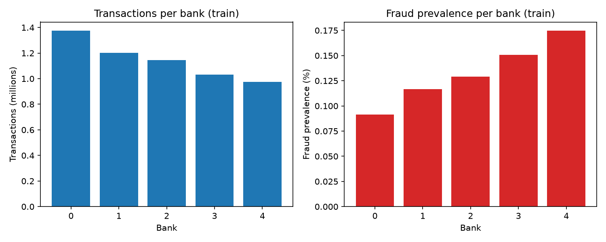
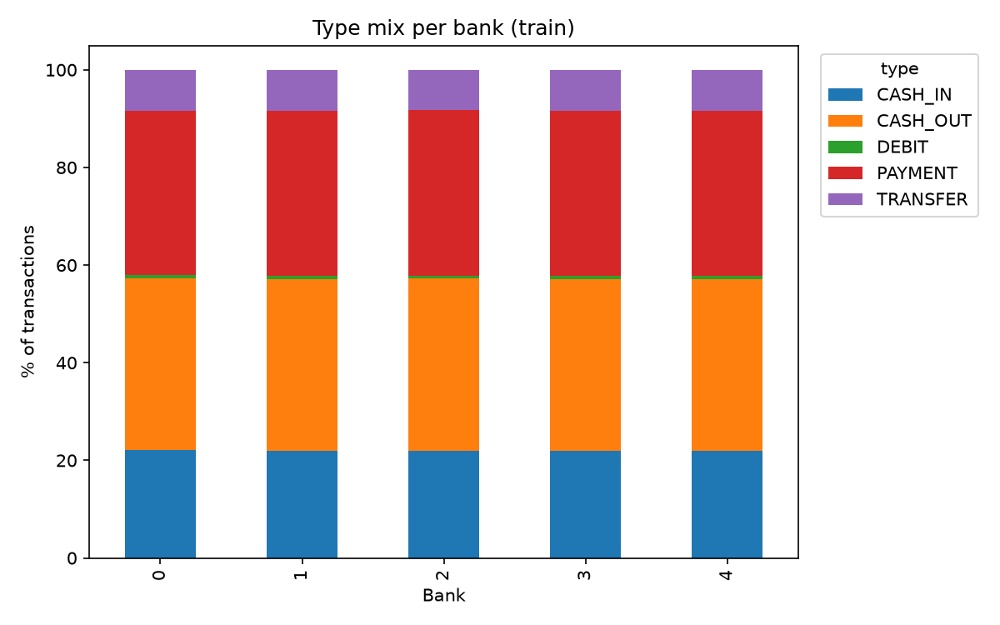
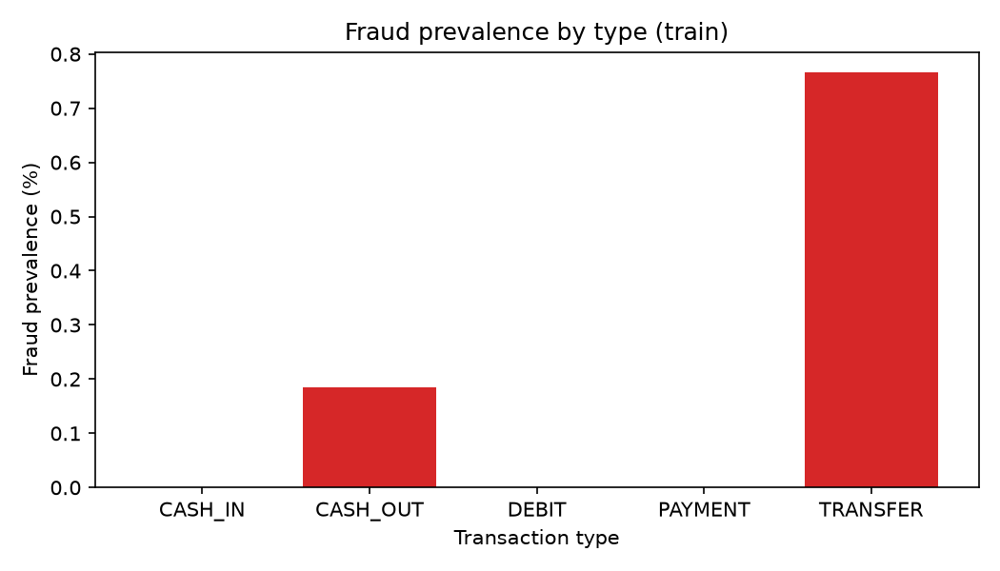
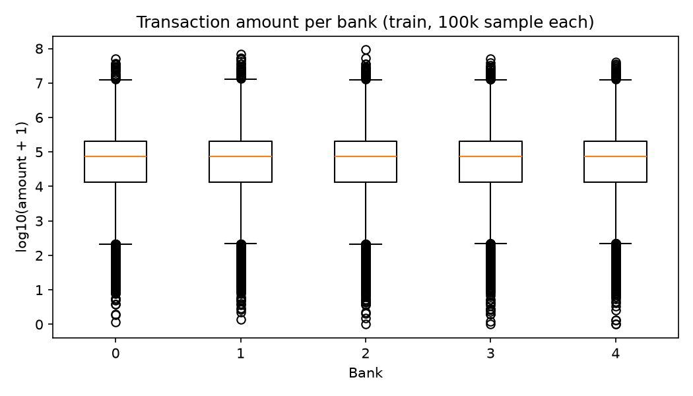

# Dataset Analysis: `flwrlabs/fed-fraud-paysim-banks`

**Member 5, Part A.** All numbers in this document come from `noniid_analysis/analyze_dataset.py`. Tables and plots are saved in `results/noniid/analysis/`. The raw data was downloaded with `noniid_analysis/download_data.py` into `data_cache/raw/` (not committed to git).

## 1. Dataset structure

| | Train | Test |
|---|---|---|
| Transactions | 5,726,358 | 636,262 |
| Fraudulent transactions | 7,392 | 821 |
| Fraud prevalence | about 0.13% | about 0.13% |

Both splits have the same 12 columns:

| Column | Meaning |
|---|---|
| `step` | time step of the transaction |
| `type` | CASH_IN, CASH_OUT, DEBIT, PAYMENT or TRANSFER |
| `amount` | transaction amount |
| `nameOrig`, `nameDest` | sending and receiving account identifiers |
| `oldbalanceOrg`, `newbalanceOrig` | sender balance before and after |
| `oldbalanceDest`, `newbalanceDest` | receiver balance before and after |
| `isFraud` | label (1 = fraud) |
| `isFlaggedFraud` | rule-based flag from the original PaySim data |
| `BankID` | simulated bank, 0 to 4 |

There are five simulated banks (`BankID` 0 to 4) in both splits. Every row is assigned to exactly one bank through `BankID`.

## 2. The five banks

### Training set

| Bank | Transactions | Share | Fraud cases | Fraud prevalence |
|---|---|---|---|---|
| 0 | 1,374,326 | 24% | 1,256 | 0.091% |
| 1 | 1,202,535 | 21% | 1,404 | 0.117% |
| 2 | 1,145,272 | 20% | 1,479 | 0.129% |
| 3 | 1,030,745 | 18% | 1,553 | 0.151% |
| 4 | 973,480 | 17% | 1,700 | 0.175% |

### Test set

| Bank | Transactions | Share | Fraud cases | Fraud prevalence |
|---|---|---|---|---|
| 0 | 152,703 | 24% | 140 | 0.092% |
| 1 | 133,615 | 21% | 156 | 0.117% |
| 2 | 127,252 | 20% | 164 | 0.129% |
| 3 | 114,527 | 18% | 172 | 0.150% |
| 4 | 108,165 | 17% | 189 | 0.175% |

Observations:

- Bank sizes are deliberately unequal (24%, 21%, 20%, 18%, 17% of the data).
- Fraud prevalence rises steadily from bank 0 to bank 4, almost two times.
- The test set has the same bank shares and fraud rates as the training set (within rounding), so it mirrors the training distribution.



Source files: `bank_summary.csv`, `bank_size_and_fraud_rate.png`.

## 3. Transaction types

### Type mix per bank (training set, % of the bank's transactions)

| Bank | CASH_IN | CASH_OUT | DEBIT | PAYMENT | TRANSFER |
|---|---|---|---|---|---|
| 0 | 22.07 | 35.17 | 0.66 | 33.76 | 8.35 |
| 1 | 21.94 | 35.17 | 0.64 | 33.84 | 8.40 |
| 2 | 21.95 | 35.26 | 0.65 | 33.83 | 8.31 |
| 3 | 22.00 | 35.17 | 0.66 | 33.77 | 8.40 |
| 4 | 22.00 | 35.06 | 0.65 | 33.88 | 8.40 |

The type mix is almost identical in every bank, with differences of about 0.1 percentage points. The test set shows the same pattern.



### Fraud by type

| Type | Train transactions | Train fraud | Train fraud rate | Test fraud | Test fraud rate |
|---|---|---|---|---|---|
| CASH_IN | 1,259,516 | 0 | 0% | 0 | 0% |
| CASH_OUT | 2,013,883 | 3,722 | 0.185% | 394 | 0.176% |
| DEBIT | 37,336 | 0 | 0% | 0 | 0% |
| PAYMENT | 1,936,298 | 0 | 0% | 0 | 0% |
| TRANSFER | 479,325 | 3,670 | 0.766% | 427 | 0.797% |

Fraud occurs **only** in CASH_OUT and TRANSFER. TRANSFER is the riskiest type. This matters for the partitions in Part B: changing the type distribution of a bank also changes how much fraud it can contain.



Source files: `type_counts_*.csv`, `type_pct_by_bank_*.csv`, `fraud_by_type_*.csv`.

## 4. Amounts

Training set, per bank:

| Bank | Mean | Median | 99th percentile | Maximum |
|---|---|---|---|---|
| 0 | 179,228 | 75,253 | 1,599,864 | 71,172,480 |
| 1 | 179,897 | 74,769 | 1,620,096 | 67,500,761 |
| 2 | 179,707 | 74,882 | 1,609,285 | 92,445,517 |
| 3 | 179,311 | 74,940 | 1,612,867 | 73,823,490 |
| 4 | 180,509 | 74,337 | 1,630,600 | 63,294,840 |

The amount distribution is essentially the same in all banks. It is heavily right-skewed (the mean is more than twice the median and the maximum reaches tens of millions), so the plot uses a logarithmic scale.



Source files: `numeric_stats_*.csv` (statistics for `step`, `amount` and the four balance columns), `amount_per_bank_log.png`.

## 5. Data quality

| Check | Train | Test |
|---|---|---|
| Rows | 5,726,358 | 636,262 |
| Missing values | 0 | 0 |
| Duplicate rows | 0 | 0 |
| Unexpected transaction types | none | none |
| Negative values (any numeric column) | 0 | 0 |
| Rows with amount = 0 | 15 | 1 |
| Rows with `isFlaggedFraud` = 1 | 14 | 2 |
| Of those, rows that are real fraud | 14 | 2 |
| Distinct `nameOrig` accounts | 5,718,821 | 636,162 |
| `nameOrig` accounts appearing in more than one bank | 0 | 0 |

Notes:

- `isFlaggedFraud` is almost never set: it catches 14 of the 7,392 training frauds, so it carries almost no information.
- Every sending account belongs to exactly one bank, and almost every account appears once.
- The ten columns other than `BankID` and `isFraud` identify each training row uniquely (no duplicates), which is what allows partitions to be matched to rows by content in Part B.
- A simple balance-consistency check (old balance minus amount equals new balance) failed on about 80% of rows. That check ignores transaction-type logic (for example, CASH_IN increases the balance), so it is **not** reported as an error in the data.

Source files: `quality_checks_train.csv`, `quality_checks_test.csv`.

## 6. Existing partitioning of the dataset

The dataset ships with its own bank assignment (`BankID`). Based on the analysis above:

- Banks differ in **size** (24% down to 17%) and in **fraud prevalence** (0.091% up to 0.175%).
- Banks do **not** differ in **transaction type mix** or in **amount distribution**.
- Sending accounts do not span banks.

The original partition is therefore already non-IID in volume and fraud rate, but approximately IID in transaction types and amounts. This determines which additional partitions are needed in Part B: IID (to remove the existing differences), fraud-prevalence skew and transaction-type skew (to create differences the original data does not have).

## 7. Reproducing this analysis

From the repository root, with the dataset downloaded:

```
python noniid_analysis/download_data.py
python noniid_analysis/analyze_dataset.py
```

Outputs are written to `results/noniid/analysis/`.
