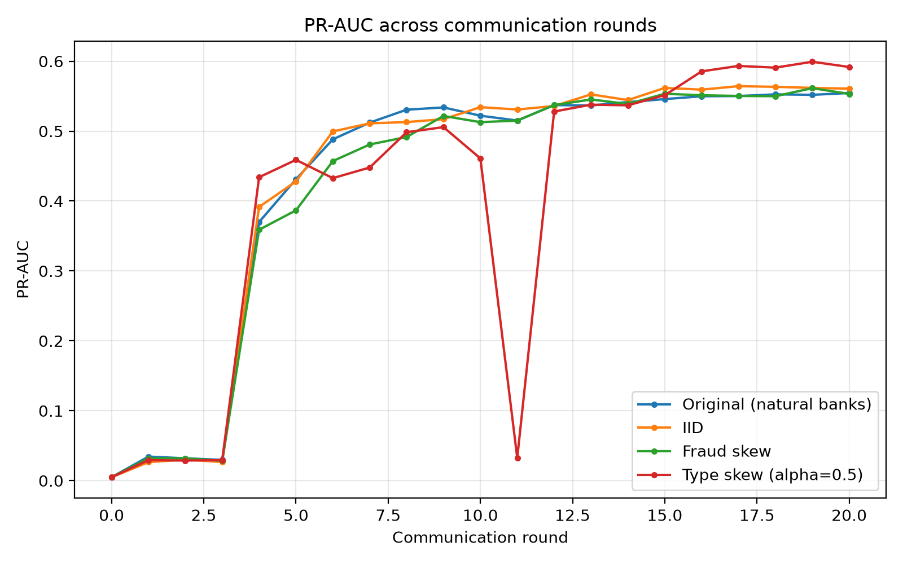
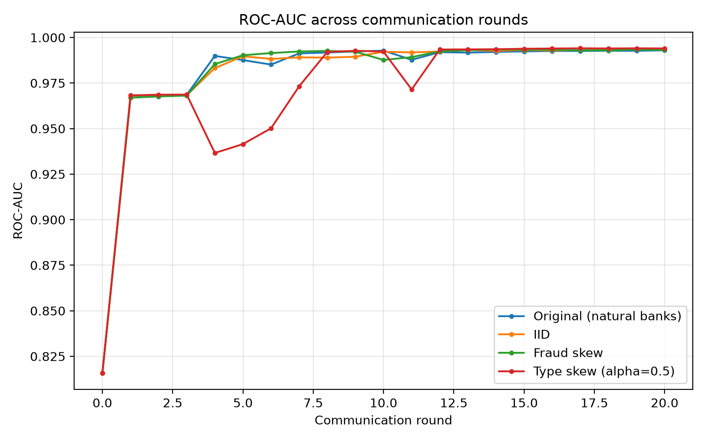
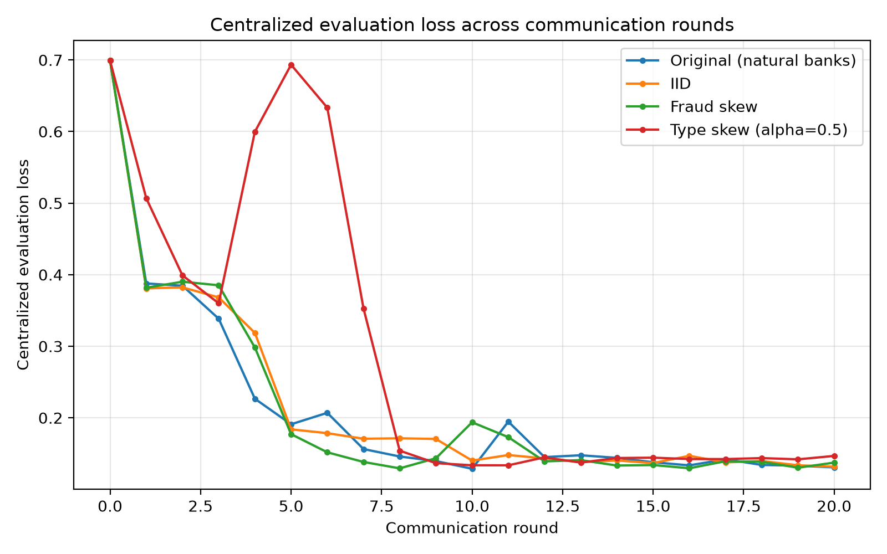
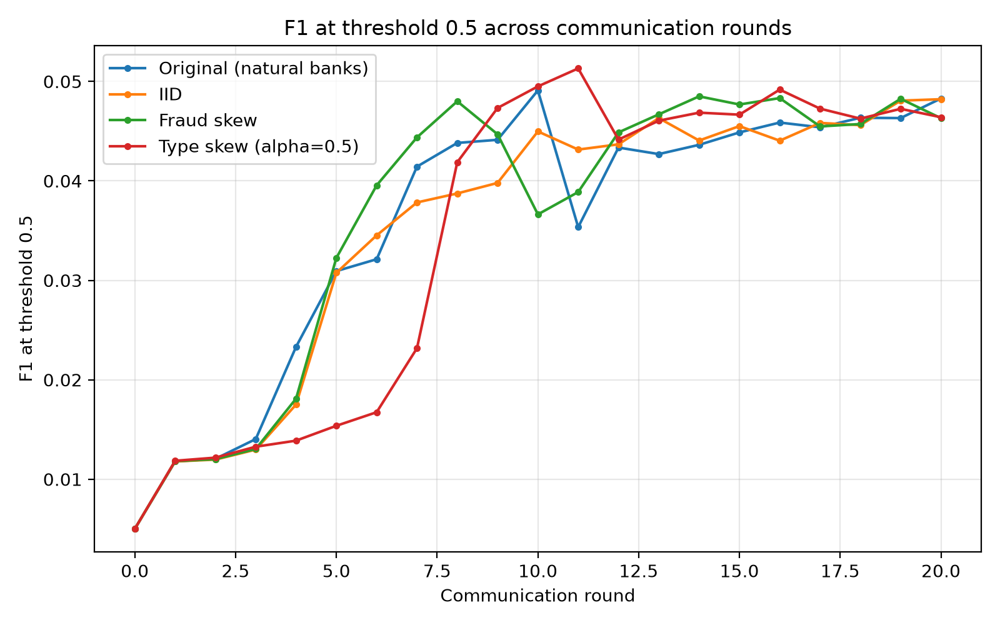

# Partitioning Methodology and Heterogeneity Experiments

**Member 5, Parts B and C.** This document describes how the additional bank partitions were built, how they were verified, how they were plugged into the Flower FedAvg application, and the results of running FedAvg on each of them.

Scripts: `noniid_analysis/partitions.py`, `noniid_analysis/partition_stats.py`, `noniid_analysis/partition_lookup.py`, `noniid_analysis/plot_results.py`, `noniid_analysis/run_partitions.ps1`.
Outputs: `results/noniid/partitions/` (partition statistics) and `noniid_analysis/flwr_app/comparison_outputs/` (experiment comparison).

## 1. Design principles

- **Only the bank assignment changes.** Every partition reuses exactly the same training rows and only reassigns `BankID`. The preprocessing, the validation split and the test set are identical across experiments, so differences in results come from the partition alone.
- **Training data only.** No partition touches the test set.
- **Reproducible.** Each partition is generated from a fixed seed (seed 0 for all four partitions used here).
- **Single-factor comparisons where possible.** IID changes the distributions of all banks, fraud skew changes only fraud prevalence. Type skew changes several things at once (see section 3.4).

## 2. The four partitions

### 2.1 Original

The dataset's own `BankID` (baseline). Differences between banks: size and fraud prevalence (see `dataset_analysis.md`).

### 2.2 IID

- Training rows are grouped by (`isFraud`, `type`) and each group is shuffled with the seed.
- Each group is then split across the five banks in the proportions of the original bank sizes (24/21/20/18/17%).
- Result: every bank has the same fraud prevalence and the same transaction-type mix, while the bank sizes stay (almost exactly) the same as in the original partition.

This differs from Flower's built-in `iid` partitioner, which assigns rows uniformly at random and produces equal-sized banks. The stratified version isolates the effect of the data distribution from the effect of bank size. **Results for "IID" in this document always refer to the stratified version.**

### 2.3 Fraud-prevalence skew

- The original bank sizes are kept.
- The 7,392 fraud cases are shuffled and distributed in the proportions 50%, 25%, 15%, 7% and 3% to banks 0 to 4.
- Each bank is filled up to its original size with shuffled legitimate transactions.

### 2.4 Transaction-type skew (Dirichlet, alpha = 0.5)

- For each transaction type, the rows are shuffled and split across the five banks with random proportions drawn from a Dirichlet distribution with concentration alpha = 0.5 (a low alpha concentrates a type in a few banks).
- The draw is repeated (with a different sub-seed) until every bank holds at least 100 fraud cases, so that no bank has nothing to learn from (up to 200 attempts).
- Bank sizes are a consequence of the type split and are no longer equal to the original sizes.

## 3. Measured properties of the partitions

### 3.1 Summary

| Partition | Largest/smallest bank | Fraud rate range | Fraud rate ratio | Fewest fraud cases in a bank | Type-mix distance (mean / max) |
|---|---|---|---|---|---|
| Original | 1.41x | 0.091% to 0.175% | 1.9x | 1,256 | 0.0008 / 0.0011 |
| IID | 1.41x | 0.129% to 0.129% | 1.0x | 1,257 | 0.0000 / 0.0000 |
| Fraud skew | 1.41x | 0.023% to 0.269% | 11.8x | 222 | 0.0006 / 0.0009 |
| Type skew (alpha 0.5) | 8.07x | 0.009% to 0.344% | 40.2x | 102 | 0.351 / 0.539 |

The type-mix distance is the total variation distance between a bank's type mix and the overall mix (0 means identical, 1 means disjoint). Source: `results/noniid/partitions/partition_summary.csv` and `partition_per_bank.csv`.

### 3.2 Per-bank details (training set)

| Partition | Bank | Transactions | Fraud cases | Fraud rate |
|---|---|---|---|---|
| IID | 0 | 1,374,327 | 1,774 | 0.129% |
| IID | 1 | 1,202,533 | 1,552 | 0.129% |
| IID | 2 | 1,145,273 | 1,479 | 0.129% |
| IID | 3 | 1,030,745 | 1,330 | 0.129% |
| IID | 4 | 973,480 | 1,257 | 0.129% |
| Fraud skew | 0 | 1,374,326 | 3,696 | 0.269% |
| Fraud skew | 1 | 1,202,535 | 1,848 | 0.154% |
| Fraud skew | 2 | 1,145,272 | 1,109 | 0.097% |
| Fraud skew | 3 | 1,030,745 | 517 | 0.050% |
| Fraud skew | 4 | 973,480 | 222 | 0.023% |
| Type skew | 0 | 256,334 | 355 | 0.139% |
| Type skew | 1 | 582,879 | 2,003 | 0.344% |
| Type skew | 2 | 1,192,390 | 102 | 0.009% |
| Type skew | 3 | 1,627,346 | 2,586 | 0.159% |
| Type skew | 4 | 2,067,409 | 2,346 | 0.114% |

### 3.3 Type mix per bank in the type-skew partition (% of the bank's transactions)

| Bank | CASH_IN | CASH_OUT | DEBIT | PAYMENT | TRANSFER |
|---|---|---|---|---|---|
| 0 | 68.04 | 3.93 | 0.08 | 11.73 | 16.23 |
| 1 | 18.83 | 40.62 | 5.65 | 0.41 | 34.48 |
| 2 | 42.53 | 0.14 | 0.19 | 56.07 | 1.07 |
| 3 | 28.59 | 32.32 | 0.01 | 25.61 | 13.47 |
| 4 | 0.14 | 59.94 | 0.09 | 39.59 | 0.23 |

### 3.4 Why type skew is confounded

Fraud only occurs in CASH_OUT and TRANSFER (see `dataset_analysis.md`). Moving transaction types between banks therefore also moves fraud and changes bank sizes: in this partition the bank sizes differ by 8.1x and the fraud rates by 40x. Any difference in the results of this condition is a **combined effect** of the type distribution, the bank sizes and the fraud rates, and must not be attributed to type skew alone. Bank 2 has only 102 fraud cases.

## 4. Matching partitions to the Flower data pipeline

### 4.1 Problem

Flower Datasets shuffles the dataset before splitting it, so the rows reach the clients in a different order than in the downloaded file. Verified: the first rows of bank 0 loaded through Flower do not match the first rows of bank 0 in the saved parquet file. Applying a partition by row position would therefore silently place transactions in the wrong banks.

### 4.2 Solution: match rows by content

- The ten columns other than `BankID` and `isFraud` identify every training row uniquely (no duplicates among 5,726,358 rows).
- For each partition, `partition_lookup.py` computes a hash of these ten columns for every row and stores a sorted lookup `hash -> bank` (`lookup_<name>_seed0.npz`, about 51 MB each).
- `LookupPartitioner` (Flower `Partitioner` subclass) hashes the rows it receives, finds them in the lookup and assigns each row to the right bank. Rows are hashed in chunks of 200,000 to keep memory low (hashing all rows at once with five parallel clients exhausted the 15 GB of RAM of the development laptop and crashed a run).

### 4.3 Verification

- Every row was found in the lookup (the partitioner raises an error otherwise).
- The `original` lookup reproduces the dataset's own banks exactly: all five banks contain only their own `BankID`, with the exact original row counts and fraud counts.
- The IID, fraud-skew and type-skew lookups reproduce the bank sizes and fraud counts in section 3.2 when loaded through Flower.

## 5. Integration with the FedAvg application

Member 3's application lives in `fedavg/` and is **not modified**. For the experiments, a copy of it is kept in `noniid_analysis/flwr_app/` with these additions:

- `fed_fraud_noniid/lookup_partitioner.py`: the `LookupPartitioner` class.
- `fed_fraud/task.py` (copy): one import line and a 3-line block in `_make_partitioner` so that partitioner names starting with `lookup_` use `LookupPartitioner`. This is the only change to Member 3's code, and it exists only in the copy.
- `pyproject.toml` (copy): points to the `fed_fraud_noniid` wrapper modules. A wrapper-only approach (patching `_make_partitioner` from outside) did not reach the Ray client processes, which is why the change is made in the copy of `task.py`.
- Lookups are read from `~/fedfraud_lookups` (or the folder named in the environment variable `FEDFRAUD_LOOKUP_DIR`).

A partition is selected with `--run-config 'partitioner="lookup_<name>_seed0"'`, for example `lookup_iid_seed0`.

## 6. Experiment setup (Part C)

All runs use FedAvg with the settings of `pyproject.toml`:

| Setting | Value |
|---|---|
| Strategy | FedAvg |
| Communication rounds | 20 |
| Clients | 5 (one per bank), all participating every round |
| Local epochs | 2 |
| Batch size | 1024 |
| Learning rate | 1e-4 (max) to 1e-5 (min) |
| Model | MLP with hidden layers 128 and 64, dropout 0.1, class-weighted loss |
| Seed | 42 (`PYTHONHASHSEED=42`) |

Environment: Python 3.12, Flower 1.44.0, PyTorch 2.10.0, Ray 2.56.0 (Flower simulation did not run on Python 3.14 in our setup because Ray was not available). The simulation was run on CPU on a laptop with 15 GB of RAM, with the number of simulated clients set to 5 (`flwr federation simulation-config @none/default local --num-supernodes 5`).

The global model is evaluated by the server after every round (round 0 is the untrained model). Metrics: PR-AUC, ROC-AUC, and precision, recall, F1 and accuracy at threshold 0.5, plus the evaluation loss. Per-round values are in `partition_comparison_all_rounds.csv`.

*To verify:* the server evaluation runs 622 batches of 1024 per round, which corresponds to the 636,262 transactions of the test set. This was inferred from the batch count and should be confirmed in the evaluation code in `task.py`.

### 6.1 Validity checks

- Each run's communication file reports 8,890,800 bytes in total (444,540 per round), which corresponds to 5 clients.
- Two earlier runs (fraud skew and type skew) used only 2 simulated clients because the client-count setting was lost, and showed 3,556,320 bytes (177,816 per round). They were detected from the communication files, **discarded** and rerun with 5 clients. Only the five-client runs are used here.

## 7. Results

One run (seed 42) per condition. Final round (round 20):

| Partition | PR-AUC | ROC-AUC | F1 at 0.5 | Evaluation loss |
|---|---|---|---|---|
| Original (natural banks) | 0.5545 | 0.9930 | 0.0483 | 0.1307 |
| IID | 0.5608 | 0.9936 | 0.0482 | 0.1317 |
| Fraud skew | 0.5533 | 0.9931 | 0.0463 | 0.1374 |
| Type skew (alpha 0.5) | 0.5918 | 0.9940 | 0.0464 | 0.1467 |









### 7.1 Observations

The values below are read from the per-round data and plots; they are approximate where marked.

- **Final performance is similar for the original, IID and fraud-skew partitions** (PR-AUC 0.553 to 0.561, ROC-AUC 0.993 to 0.994). The differences (about 0.01) are of the same size as the round-to-round fluctuations of the curves, and each condition has a single seed, so no ranking among these three can be concluded.
- **All four conditions behave alike in the first rounds:** PR-AUC stays near 0.03 until round 3 and jumps at round 4 (to roughly 0.36 to 0.43).
- **Fraud skew** was slightly slower in the middle rounds (PR-AUC roughly 0.39 to 0.46 in rounds 5 and 6 against roughly 0.43 to 0.50 for the original and IID partitions, approximate) and reached the same final level.
- **Type skew** has the highest final PR-AUC (0.5918) but was the least stable condition:
  - In the early rounds its evaluation loss rose to about 0.69 around round 5 while the other conditions' loss fell, and its ROC-AUC was lower (about 0.94 at round 4).
  - At round 11 its PR-AUC dropped to about 0.03 for one round and recovered to about 0.53 at round 12. In that round its loss stayed normal (about 0.13) and its ROC-AUC only fell to about 0.97. One possible explanation is that PR-AUC is very sensitive to the ordering of the highest-scored transactions when fraud is only about 0.13% of the data. This was **not tested**.
  - With one seed it is not known whether this instability repeats.
- **F1 at threshold 0.5 is low for all conditions (about 0.046 to 0.048)** because precision at that threshold is about 0.025. It is threshold dependent: the training logs report F1 of roughly 0.5 to 0.66 at thresholds 0.95 and 0.99. PR-AUC and ROC-AUC are the more meaningful metrics for comparing the partitions.

### 7.2 Answers to the questions of the task

- **Does fraud-prevalence skew have a negative impact on global model performance?** In this experiment, not on the final result: PR-AUC 0.5533 against 0.5545 (original) and 0.5608 (IID). There is a small slowdown in intermediate rounds. With one seed, an effect smaller than the run-to-run noise cannot be excluded.
- **Does transaction-type skew affect the model's ability to generalize across banks?** Not on the final PR-AUC or ROC-AUC of the global model on the common evaluation set, but it made training visibly less stable (higher early loss, collapse at round 11). Because this partition also changes bank sizes and fraud rates (section 3.4), the effect cannot be attributed to the type distribution alone.
- **IID versus the original partition:** final PR-AUC 0.5608 against 0.5545, a difference within the noise of a single seed. The original partition is only mildly heterogeneous (fraud rate ratio 1.9x, no difference in type mix), so a small gap was expected.

## 8. Limitations

- **One seed per condition.** The task asks for three seeds where computationally feasible. Mean and standard deviation could not be computed, and no statistical claim is made.
- **Type skew is confounded** (bank sizes, fraud rates, types change together).
- **Two definitions of IID exist** (Flower's equal-size random split and the stratified version used here). Only the stratified version was run.
- **Evaluation is on the common evaluation set.** Bank-specific test sets were not used, since the synthetic partitions have no meaningful bank-specific test data.
- **The partitions are single draws** (seed 0). A different seed would give a different fraud-skew assignment and a different type-skew proportion matrix.
- **No hyperparameter changes.** All conditions use the same hyperparameters as the original benchmark configuration.

## 9. Reproducing the experiments

From the repository root, with the dataset downloaded (`python noniid_analysis/download_data.py`):

```
# 1. Build the lookups (about 51 MB each) and copy them to the folder used by the client processes
python noniid_analysis/partition_lookup.py
New-Item -ItemType Directory $HOME\fedfraud_lookups -Force
Copy-Item data_cache\partitions\lookup_*.npz $HOME\fedfraud_lookups

# 2. Run FedAvg on each partition (Python 3.12 environment, five simulated clients)
pip install -e noniid_analysis\flwr_app
powershell -ExecutionPolicy Bypass -File .\noniid_analysis\run_partitions.ps1

# 3. Build the comparison table and plots
python noniid_analysis\plot_results.py
```

`run_partitions.ps1` sets the number of simulated clients to 5 before every run and skips partitions whose result file already exists. Each run saves `result_<name>_seed0_r20.pkl` and a `_communication.json` file in `noniid_analysis/flwr_app/`.
